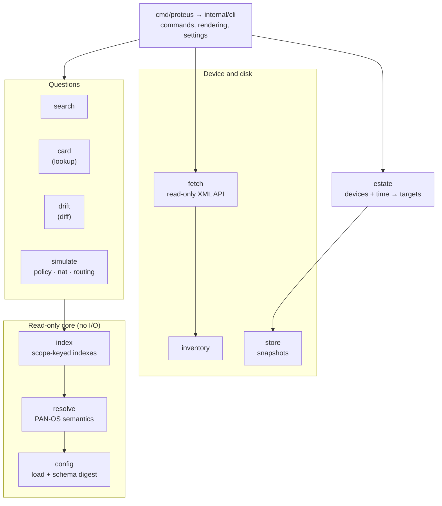
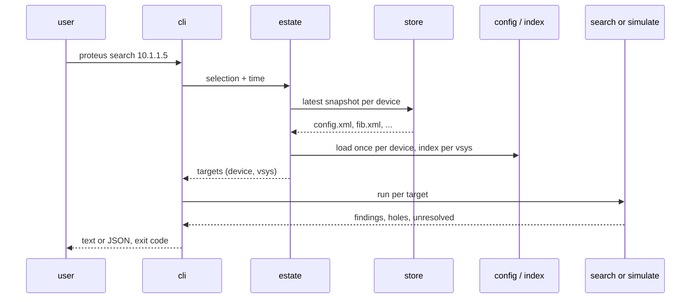

# Architecture

This page describes how proteus is built: the packages, how data flows through
them, and the rules that hold the design together. `ARCHITECTURE.md` in the
repository root holds the reasoning behind each decision.

## Design goals

- **Read-only.** proteus never changes a firewall. The API client refuses every
  command that is not a `<show>` command or a configuration export.
- **Correct before complete.** An answer that may be incomplete says so. A wrong
  answer that looks complete is the worst outcome.
- **Schema first.** Knowledge about configuration fields comes from the PAN-OS
  schema, not from hand-written code.
- **Scope-correct.** Every answer is keyed by device and vsys. Nothing resolves a
  name across all scopes.

## Layers

Dependencies point one way: down. The core imports no network or process package.
A test (`internal/archtest`) fails the build when an import breaks this rule.

## Packages

| Package | Job |
| --- | --- |
| `cmd/proteus` | the `main` package: signal handling and version, then `cli.Run` |
| `internal/cli` | the commands, their text and JSON output, and the settings |
| `internal/config` | loads a configuration into an element tree; attaches the schema digest |
| `internal/resolve` | PAN-OS semantics: vsys targets, rule order, object visibility, groups, tag filters, URL patterns, zones, routes |
| `internal/index` | scope-keyed indexes: references, group closure, address containment, rule bitmaps |
| `internal/search` | the four search stages for one scope |
| `internal/card` | the whole rule or object behind a name |
| `internal/drift` | changes between two configurations of a scope |
| `internal/simulate` | the staged simulation framework and fidelity |
| `internal/simulate/securitypolicy` | security rule matching |
| `internal/simulate/nat` | NAT rule matching and translation |
| `internal/simulate/routing` | paths across firewalls |
| `internal/simulate/topology` | interfaces and forwarding tables, shared by simulations |
| `internal/simulate/rulebase` | rulebase address matching and the PBF check |
| `internal/estate` | turns a selection and a time into the configurations a question reads |
| `internal/inventory` | the device list, credentials and TLS choice |
| `internal/fetch` | the read-only XML API client and the list of documents |
| `internal/store` | timestamped snapshots on disk, `latest` and retention |
| `internal/runlog` | one log file per run, with secret redaction |
| `internal/schema` | parses the PAN-OS schema grammar |
| `internal/digest` | the compact schema digest format |
| `internal/tools/schemadigest` | developer tool: turns a firewall's `schema.xml` into a digest |

## Data flow of a question

A device that cannot be read becomes a **hole**. The question runs on the rest.

## The schema digest

Every firewall carries its configuration schema at
`/opt/pancfg/mgmt/factory/schema.xml`. The schema says:

- which fields exist and their types, limits and defaults;
- whether a list holds named entries or plain members;
- which objects a field may reference (`memberof`).

`internal/tools/schemadigest` turns the schema into a compact gzipped digest.
The digest is committed in `internal/config/schemadigest/` and embedded in the
binary. One digest reads every configuration. `config` does not check the
configuration's PAN-OS version.

`resolve` and `index` read the configuration as an element tree, guided by the
digest. They do not use generated Go structs, so a newer schema needs a new
digest and no code change.

## Simulation framework

A simulation is a sequence of named **stages** over one flow and one device. Each
stage narrows a candidate set and declares its **fidelity**: `exact`,
`overmatch`, `inferred` or `undermatch`. The run's fidelity is the weakest stage's.
It is computed, not claimed.

The framework (`internal/simulate`) knows no simulation kind. Each kind lives in
its own package and plugs its stages into the stepper.

## Rules

The repository's `AGENTS.md` lists the rules that every package follows. Each
rule names the test that enforces it. The most important:

| Rule | Summary |
| --- | --- |
| R1 | Field knowledge comes from the schema only. |
| R2 | Read-only everywhere. |
| R3 | Nothing is dropped silently. |
| R5, R10 | Resolution and indexes are keyed by scope. |
| R9 | Every claim about PAN-OS behaviour cites its source. |
| R12 | Imports point one way; the core has no I/O. |
