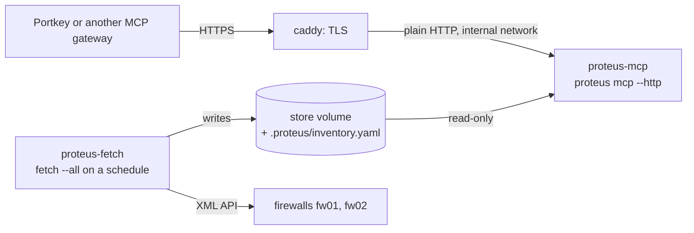

# mcp

`mcp` serves the Proteus questions to an agent, or to a chatbot behind an MCP gateway, over the Model Context Protocol (MCP).

## Synopsis

```text
proteus mcp [flags]
proteus mcp --http [flags]
```

## Tools

| Tool | Question | Command |
| --- | --- | --- |
| `simulate_policy` | Does the estate allow this flow, and which rule decides on each hop? | [`simulate policy`](simulate-policy.md) |
| `simulate_routing` | Which firewalls does this packet cross? | [`simulate routing`](simulate-routing.md) |
| `simulate_nat` | Which NAT rule does this packet hit on one firewall, and how is it translated? | [`simulate nat`](simulate-nat.md) |
| `search` | Where does this address, prefix, port or name appear? | [`search`](search.md) |
| `lookup` | What does this rule or object contain? | [`lookup`](lookup.md) |
| `snapshot_diff` | What changed on a device between two snapshots? | [`snapshot diff`](snapshot.md) |

The server reads the snapshot store only, so `simulate policy --file` has no tool.
Each tool reads the latest snapshot of each device, or the newest snapshot at or
before `at`. A date in `at` means the end of that day.

| Tool | Inputs |
| --- | --- |
| `simulate_policy` | `source`, `destination`, `protocol`, `port`, `source_port`, `url`, `application`, `user`, `device`, `router`, `at`, `detail` |
| `simulate_routing` | `source`, `destination`, `protocol`, `port`, `device`, `router`, `at`, `detail` |
| `simulate_nat` | `source`, `destination`, `protocol`, `port`, `device` (required), `router`, `at`, `detail` |
| `search` | `value`, `kind`, `device` (list), `label` (list), `vsys`, `at`, `detail`, `limit` |
| `lookup` | `name`, `kind`, `device` (list), `vsys`, `at`, `detail`, `limit` |
| `snapshot_diff` | `device`, `from`, `to`, `detail`, `limit` |

| Input | Rule |
| --- | --- |
| `source`, `destination` | an address or a host name; the server resolves a host name with its own DNS and checks the first IPv4 address |
| `port`, `source_port` | a number from 1 to 65535 |
| `protocol` | `tcp`, `udp`, `icmp` or `sctp`; `simulate_policy` also takes an IP protocol number from 0 to 255, such as 89 for `ospf`; the form `tcp/443` is refused |
| `protocol` left out | `simulate_routing` and `simulate_nat` use `tcp`; `simulate_policy` with `application` uses the protocol of the application's default |
| `protocol` left out in `simulate_policy` without `application` | no default; a rule that needs the protocol holds the answer back, and `needs` asks for it |
| `application` | a predefined or custom application, matched with the App-ID data of each hop's snapshot; see [simulate policy](simulate-policy.md#applications) |
| `application` that a hop's data does not hold | that hop stays undecided |
| `device` | an enum of the exported devices; the client sees the names in the input schema, and the server refuses any other name |
| `detail` | `summary` (the default) or `full` |
| `limit` | 1 or more, with no default; it keeps the first N results over all devices together |

`search` and `lookup` find applications, filters and containers with the App-ID
data, as the command line does. The input schema of each tool describes what
Proteus evaluates for each input.

A result for `limit` is a finding for `search`, a card for `lookup`, and a single
change for `snapshot_diff`. In `snapshot_diff`, the scope where the limit falls
keeps its first changes, and the later scopes are left out. The summary's `found`
counts every result, and `omitted` counts the results left out. The answer line
then ends `; 5 of 812 shown, narrow by device, vsys or kind`. Holes, unresolved
entries and notes are never cut. A model should pass `limit` for a broad search,
such as a large prefix or a common port, so that the answer fits its context.

## Examples

### Start the server for a local agent

```bash
proteus fetch --all          # with export_inventory: true in the inventory
proteus mcp                  # stdio: for a local agent
```

The server reads its device list from `<store>/.proteus/inventory.yaml`, the
[inventory export](../reference/configuration.md#the-inventory-export) that
`fetch` writes. It never reads the inventory with credentials. A change of
devices needs a new fetch and a server restart.

### Call a tool

A client sends a `tools/call` request over standard input:

```json
{"jsonrpc":"2.0","id":2,"method":"tools/call","params":{"name":"snapshot_diff","arguments":{"device":"fw01"}}}
```

The text content of the answer reads:

```text
1 with changes, 0 without, 0 holes
fw01/shared: 0 added, 0 removed, 0 changed
fw01/vsys:vsys1: 1 added, 1 removed, 2 changed
fw01/vsys:vsys2: 0 added, 0 removed, 0 changed
```

The structured content holds the same answer as the JSON envelope of
`proteus snapshot diff --output json --detail summary`. A call without `detail`
gets `summary`.

### Serve HTTP behind a TLS proxy

```text
$ proteus mcp --http --listen 127.0.0.1:18765 --token-file token --audit-log audit.jsonl --allowed-host localhost
proteus mcp: serving http://127.0.0.1:18765 (Host check on: localhost)
```

The server prints its start line on stderr. It listens on `--listen` (default
`127.0.0.1:8765`) and serves plain HTTP, so put a reverse proxy that terminates
TLS in front of it. Without `allowed_hosts`, the line ends `(Host check off)`.

!!! warning
    A token holder can forge the identity. The token proves that a request comes
    through the gateway, and Proteus does not verify the identity header. Proteus
    does no authorization, so the gateway must decide who can use the server.

### Deploy with Docker

The sample in `deploy/docker/` runs Proteus in two containers behind a TLS proxy:



| Container | Role |
| --- | --- |
| `proteus-fetch` | holds the only inventory with credentials and the firewall password, both as secrets; runs `proteus fetch --all` every hour and writes the store and the export |
| `proteus-mcp` | runs `proteus mcp --http`; mounts the store read-only, holds the token as a secret, and sits on a network with no route out |
| `caddy` | terminates TLS, limits the request body to 1 MB and forwards to `proteus-mcp`; checks the server with `/healthz`; drops the `X-User-Claims` header from every log line, so only the audit holds identities |

Both Proteus containers run as UID 10001, read-only, with every capability
dropped. The server image has no shell. The comments in
`deploy/docker/compose.yaml` list the steps before the first start: the secrets,
their owner and their mode. Until the first fetch writes the export,
`proteus-mcp` exits 2 and restarts. The fetch container's script passes SIGTERM
to the running `proteus fetch` and exits 143 when it ends.

`deploy/portkey.md` registers the server in the Portkey MCP gateway. It covers
the URL, the static `Authorization: Bearer <token>` header, the identity
forwarding through `X-User-Claims`, and an address filter at the proxy.

## Reading the output

### Structured content

Each tool returns structured content of the form `{envelope, error}`:

| Key | Content |
| --- | --- |
| `envelope` | the JSON format 2 envelope of [Output](../reference/output.md): `format`, `command`, `detail`, `input`, `results`, `holes`, `unresolved` and `notes`, plus `summary` for `search`, `lookup` and `snapshot_diff`; null when the call failed |
| `error` | null, or `{code, text, options, needs}` when the call failed |

The output schema of each tool holds the JSON schema of its output. The envelope
schemas are also in `schemas/out/` and in the resources below.

| Detail | Content |
| --- | --- |
| `summary` | what a model needs to answer: the answer line, `needs`, the verdict, the fidelity and its reasons, the doubts, the zones and the deciding point; a path hop keeps its device, vsys, snapshot, zones, route, doubts and check verdicts; a diff counts its changes |
| `full` | the envelope that `proteus … --output json --detail full` prints: every candidate, stage and lookup |

Ask for `full` when a person wants the reasoning behind each stage. The summary is
much shorter and leaves more room in the model's context.

A client that passes only text to the model gets a text content too. It lists the
summary's answer line, then each result's answer line, `fidelity: <level>` and
each `needs` line. The `hole:`, `unresolved:` and `note:` lines follow. An error
gives `<code>: <text>`, its options and its needs.

### Reason codes and needs

Every reason in an answer is a `{code, text}` object. The code comes from one
closed registry and reads `<class>.<name>`, such as `doubt.service-no-port` or
`note.snapshot-stale`. See [Reason codes](../reference/output.md#reason-codes).

A result that the server holds back, such as an undecided verdict or a NAT rule in
doubt, carries `needs`: the inputs that can decide it. Each entry is
`{code, input, text}`:

| Code | Input | When |
| --- | --- | --- |
| `input.protocol` | `protocol` | a rule's service needs the protocol, and the call gave none |
| `input.port` | `port` | a rule's service, a NAT rule or a PBF rule on the path needs the destination port |
| `input.url` | `url` | a rule names a URL category that the configuration defines |
| `input.application` | `application` | a rule names an application or uses `application-default`, the call gave no application, and the snapshot has App-ID data |

`needs: []` means that no input can decide the result. Examples are a predefined
service that the snapshot does not hold, an application that the App-ID data does
not hold, an application without App-ID data, and a PAN-DB category. A snapshot
lacks a predefined service when it was stored before this release or the device
refused it. A decided result has no `needs` key.

### Errors

A failed call returns `error` with one of the `call.*` codes and sets the MCP
`isError` flag. Holes, unresolved entries and undecided verdicts come back as a
normal answer with `error` null.

| Code | Cause | What to do |
| --- | --- | --- |
| `call.usage` | the inputs are not a valid question | fix the input; `text` names the input field |
| `call.choice` | no single start device or router | pick one of `options`; `needs` names the input (`device` or `router`) |
| `call.busy` | the queue is full, the call waited `max_wait`, or the server is stopping | call again later |
| `call.timeout` | the call ran longer than `call_timeout`, or the client cancelled it | ask a narrower question, or call again later |
| `call.internal` | the server failed while it answered | report it; the server keeps running |

An input that breaks the input schema, such as a device name outside the enum,
gets the SDK's own error text and no structured content. The audit records it as
`usage`.

Over HTTP, some requests do not reach a tool:

| Condition | HTTP status |
| --- | --- |
| `allowed_hosts` is set, and the Host header is not in it | 403 |
| no bearer token, or a wrong one | 401, with `WWW-Authenticate: Bearer` |
| a body above 1 MiB | 413 |
| a header block above 16 KiB | 431 |

`/healthz` needs no token and no allowed Host. It answers 200 with no body.

### Resources and instructions

| URI | Content |
| --- | --- |
| `proteus://reasons` | every reason code: code, class, description |
| `proteus://schemas/<tool>/<detail>` | the JSON schema of a tool's envelope in one detail, for each of the six tools and both details |
| `proteus://limits` | a summary of [Limits](../reference/limits.md) for a model |

The server gives the client these instructions:

```text
Report each result's verdict together with its fidelity level. Never report an undecided result, or a fidelity of inferred or undermatch, as allowed or denied. Ask the user for each input a result's needs list names, and call again with it. When a note says a snapshot is stale, state the snapshot's age. On the error call.choice, ask the user to pick one of the options and call again with it.
```

### Audit and run logs

The server appends one JSON line per call to `audit_log`, with mode 0600. Before
a line takes the file past `audit_max_mb`, the server renames the file to
`<audit_log>.<UTC time>-<sequence>` and starts a new one. It keeps the newest
`audit_keep` renamed files. With `audit_log: -` and `--http`, the lines go to
standard output, and the container platform collects and keeps them.

```json
{"time":"2026-10-10T08:00:00Z","auth":"token","identity_source":"header","identity":{"sub":"alice"},"tool":"simulate_policy","input":{"source":"198.18.1.10","destination":"198.18.10.100","port":443},"verdict":["allowed"],"verdict_count":1,"codes":[],"snapshots":["fw01@2026-10-10T07-00-00Z","fw02@2026-10-10T07-00-00Z"],"duration_ms":120,"status":"ok"}
```

| Field | Content |
| --- | --- |
| `auth` | `token` over HTTP, `stdio` over stdio |
| `identity_source` | `header`, `none` (header missing or not a JSON object) or `os` (stdio) |
| `identity` | the `audit_claims` of the identity header, each cut to 256 bytes; the operating system user over stdio; `unknown` when none is found |
| `tool`, `input` | the tool and its inputs as the client sent them |
| `verdict` | the answer lines: the summary line and the first 20 result lines |
| `verdict_count` | the number of answer lines the client received; more than the lines in `verdict` when a broad answer was cut; with `limit`, the lines of the shortened answer |
| `codes` | the reason codes of the holes, unresolved entries and notes |
| `snapshots` | the snapshots that the answer read, as `<member>@<snapshot id>`: for an HA pair the member whose snapshot answered, for a single device the device |
| `duration_ms` | the time the call took |
| `status` | `ok`, `usage`, `choice`, `busy`, `timeout` or `internal` |
| `code` | the `call.*` code of a failed call |

The audit holds only the calls that reached the server. A refused HTTP request
(401 or 403) gets no audit line. While requests are refused, the server's run log
gets one warning per minute with the counts by status, such as
`mcp: refused since the last report: 401 ×3, 403 ×1`. A count shows a wrong token
or Host, and the logs of the gateway and the proxy show who sent the requests.

The audit lines hold identities and the addresses in the tools' inputs, so treat
them as sensitive. The token never reaches the audit or a log.

A call that ends `internal` or `timeout` writes its own run log in `log_dir`,
named `mcp-<tool>-<time>-<seq>.log`:

| Content | Detail |
| --- | --- |
| the call | the input, the snapshot each device resolved to, what each stage kept, and at the end the status, the code and the duration |
| a panic | its stack |
| a call that timed out | its work goes on until it returns; the log stays open and also holds what the work logged late and the stack of a later panic |

On SIGTERM the server waits for timed-out work only until it stops: at most
`call_timeout` over stdio, and `call_timeout` + `max_wait` + 10 s over HTTP. What
the work logs after that is lost, and the lines written before stay.

Any other call keeps its log in memory and drops it, because its answer explains
itself in its reasons and codes. With `--log-level debug` (or `log_level: debug`),
every call writes its run log. The newest `log_keep` logs stay. A call that the
server refuses as busy gets an audit line and no run log.

The server process also writes one CLI run log in the CLI's log directory. It
holds the start, the settings, the refusal counts and the exit.

## Flags

Each setting comes from, in rising precedence: its default, the export's `mcp:`
section, a `PROTEUS_MCP_*` variable, and a flag. `PROTEUS_MCP_TOKEN` holds the
token itself, and no flag sets it. [The mcp section](../reference/configuration.md#the-mcp-section)
lists every key, its variable and its flag.

| Flag | Default | Description |
| --- | --- | --- |
| `--http` | off | serve Streamable HTTP on `--listen` instead of stdio |
| `--listen` | `127.0.0.1:8765` | host:port for `--http` |
| `--token-file` | none | the file that holds the bearer token; see [The token](../reference/configuration.md#the-token) |
| `--allowed-host` | none | a Host header value that `--http` answers; repeatable; none accepts any Host; see [Host check](../reference/configuration.md#host-check) |
| `--audit-log` | none | the audit file, one JSON line per call, or `-` for standard output with `--http`; required with `--http` |
| `--audit-max-mb` | `100` | the audit file's size in MB before it rotates |
| `--audit-keep` | `10` | rotated audit files kept |
| `--max-concurrent` | `4` | calls answered at once |
| `--max-queue` | `16` | calls waiting for a slot, and loads waiting for `--max-loads` |
| `--max-wait` | `10s` | how long a call waits for a slot |
| `--call-timeout` | `60s` | how long a call runs before it gets `call.timeout` |
| `--max-loads` | `2` | snapshot loads and index builds at once |
| `--max-cache` | `2048` | the cache of loaded snapshots, in MB |

The server reads the [user snapshot](../reference/configuration.md#the-user-snapshot)
that `PROTEUS_USERS` names once, at start. Every call answers from that copy, so a
changed file needs a server restart.

SIGTERM stops new calls and lets the running calls answer. An answer is written at
most `call_timeout` + `max_wait` + 10 s after its request. The whole stop ends
within that time, also when a call's work does not return or a client keeps its
request open. The server then closes what is left and exits 143. Set the
container's stop grace period to at least `call_timeout` + `max_wait` + 20 s: 90 s
with the defaults, as `stop_grace_period` in the sample. With a shorter grace, the
platform can kill the server while calls still answer.

### Cache size

The cache keeps each loaded snapshot and its indexes. It counts these items:

| Item | Size it counts |
| --- | --- |
| a loaded configuration | 32 MB plus 13 times its file size |
| the schema digest | 10 MB, once |
| an App-ID content version | 12 MB; the devices with one content version share its item |

The cache frees an old content version as it frees an old snapshot. Size
`--max-cache` with that model and the number of devices. For example, 20 devices
with 8 MB configurations and two content versions need about
20 × (32 + 13 × 8) + 10 + 2 × 12 = 2,754 MB.

`BenchmarkCacheRetention` in `internal/mcp` measures the model on two generated
shapes at about 4 and 8 MB:

| Shape | Retained |
| --- | --- |
| one vsys with 2,000 nested address groups | 29.3 MB plus 12.8 bytes per file byte; the fixed part is the group tree |
| four vsys with nested groups and NAT and PBF rules | 0.35 MB plus 12.7 bytes per file byte |
| the schema digest | about 9 MB; the benchmark fails above 10 MB |
| one content version of 5,552 applications | about 9 MB; the benchmark fails above 12 MB |

The model takes the larger value of each part, rounded up, so it overstates most
configurations: a small one by up to 32 MB.

## Exit codes

The server checks its setup before it answers, and a failed check stops it:

| Code | Cause |
| --- | --- |
| 0 | over stdio, the client closed the stream |
| 1 | the export cannot be read, the store cannot be opened, the address cannot be listened on, or the audit file cannot be opened |
| 2 | the export is missing (`run proteus fetch first`) |
| 2 | the export holds a credential, cannot be parsed, or has no device |
| 2 | `--http` without a token, with a token shorter than 32 bytes, or without `audit_log` |
| 2 | `audit_log: -` over stdio, where standard output carries MCP |
| 2 | the `PROTEUS_USERS` file is missing, cannot be read, or is not a valid user snapshot |
| 130 | Ctrl-C |
| 143 | SIGTERM, after the running calls answer |

## Limits

- The server answers with the same [limits](../reference/limits.md) as the
  command line.
- Its data is as fresh as the last `proteus fetch`.
- Proteus does no authorization, and a token holder can forge the identity.
- A timeout cannot interrupt a snapshot load or an index build.

[Limits of the MCP server](../reference/limits.md#the-mcp-server) lists them all.

### Model check

The tests prove that the server gives the right JSON. They cannot prove that a
model reads it right. The model check asks a model questions through the server
and checks its replies against four rules. Run it with the model and the gateway
that the chatbot uses, after each change of model or of the instructions.

Use the lab flows of the policy path probe, and one host name:

| # | Flow | Expected answer from Proteus |
| --- | --- | --- |
| A | 198.18.1.10 -> 198.18.10.100 tcp/443 (fw02 to fw01) | allowed |
| B | 198.18.10.100 -> 198.18.1.10 tcp/22 (the reverse) | undecided on fw01: a rule with service `application-default` |
| C | 198.18.1.68 -> 198.18.10.100 udp/443 | denied by a rule |
| D | 198.18.1.10 -> 203.0.113.10 tcp/443 | undecided: the path leaves the estate |
| E | 198.18.1.10 -> 198.18.10.100 without a port | held back; `needs` asks for the port |
| F | 198.18.1.10 -> a host name that the server's DNS resolves to 198.18.10.100 | as A, with the DNS notes |

Adapt the addresses to the lab's current rules. Run each flow with
`proteus simulate policy … --output json` first, and write down the answer that
Proteus gives. The model check compares the model's reply with that answer.

Ask each question in a new conversation, in the user's words:

| # | Question | Flow |
| --- | --- | --- |
| 1 | "Can 198.18.1.10 reach 198.18.10.100 on 443?" | A |
| 2 | "Is SSH from 198.18.10.100 to 198.18.1.10 allowed?" | B |
| 3 | "Why is it undecided?" | B, as a follow-up to question 2 |
| 4 | "Is QUIC from 198.18.1.68 to 198.18.10.100 blocked?" | C |
| 5 | "Can 198.18.1.10 reach 203.0.113.10 on 443?" | D |
| 6 | "Can 198.18.1.10 reach 198.18.10.100?" | E: the model must ask for the port |
| 7 | "Can 198.18.1.10 reach <host name> on 443?" | F |
| 8 | "Which firewalls does traffic from 198.18.1.10 to 198.18.10.100 cross?" | |
| 9 | "What NAT does fw01 apply to traffic from 198.18.1.10 to 198.18.10.100 on 443?" | |
| 10 | "Where is 198.18.10.100 used in the rules?" | |
| 11 | "What changed on fw01 since yesterday?" | |
| 12 | "Which route does traffic to 198.18.10.100 take?" | no source, so the start is a choice: the model must offer the options |

At least one question must reach a device whose snapshot is stale, so that you can
check rule 3. In the lab, fw01 is often unreachable, and its snapshot is old.

The check passes when every reply follows all four rules:

1. No undecided, inferred or undermatch answer is reported as allowed or denied.
2. Every `needs` input is asked back to the user.
3. The snapshot age is stated when a note says that the snapshot is stale.
4. A `call.choice` error leads to a question that offers the options.

A reply that states a verdict Proteus did not give also fails.

Write the result in [Limits](../reference/limits.md#model-check) under the date:

- the model and its version, the gateway, and the Proteus version
- for each question: the tool calls the model made, pass or fail, and for a fail
  the rule it broke and the reply in one line
- the total, such as "12 of 12 passed"

Keep each failed reply in the record. A fail shows where the instructions or a
description need better words.

## See also

- [Configuration: the mcp section](../reference/configuration.md#the-mcp-section)
- [Configuration: the inventory export](../reference/configuration.md#the-inventory-export)
- [Output and exit codes](../reference/output.md)
- [Limits of the MCP server](../reference/limits.md#the-mcp-server)
- [fetch](fetch.md)
- [How Proteus works](../concepts/index.md)
