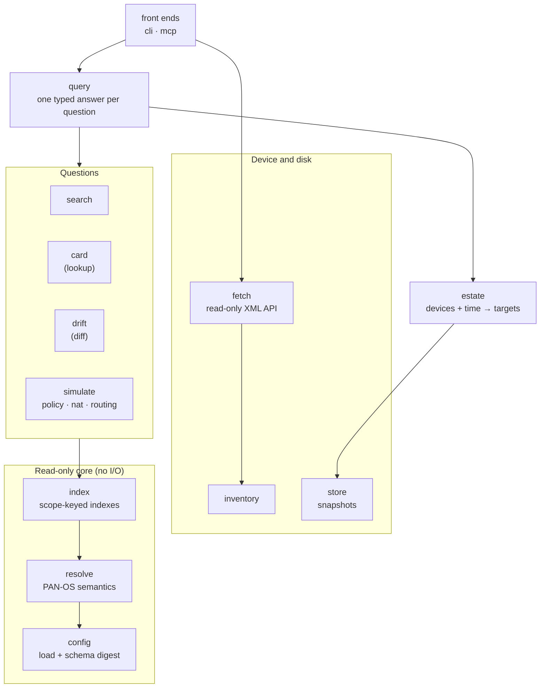
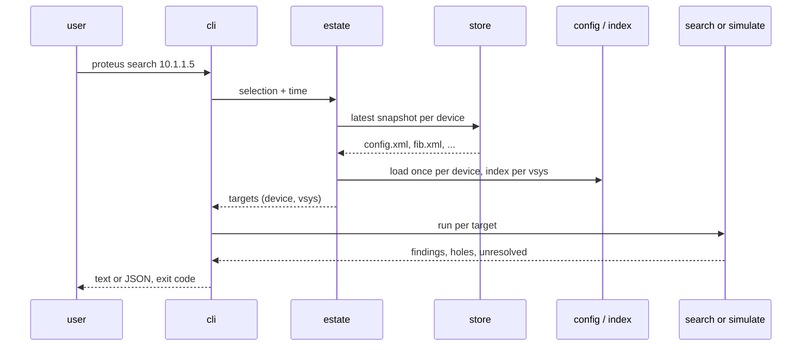

# Architecture

Proteus is one Go module with a read-only core, a set of question packages, and
front ends for the command line and MCP. `ARCHITECTURE.md` in the repository root
gives the reasoning behind each decision, and `AGENTS.md` lists the rules that
every package follows.

## Design goals

| Goal | What it means |
| --- | --- |
| Read-only | The API client sends only `<show>` commands, such as `show config running` and `show config pushed-template`, and the configuration export as the fallback. proteus merges the running configuration and the pushed template itself. |
| Correct before complete | An answer that may be incomplete says so. A wrong answer that looks complete is the worst outcome. |
| Schema first | Field knowledge comes from the PAN-OS schema. |
| Scope-correct | Every answer is keyed by device and vsys. See [Scope](scope.md). |

## Layers

Dependencies point down. The core imports no network or process package, and
`internal/archtest` fails the build when an import breaks this rule.

## Packages

| Package | Job |
| --- | --- |
| `cmd/proteus` | the `main` package: signal handling and version, then `cli.Run` |
| `internal/cli` | the commands, their text output and the settings |
| `internal/mcp` | the MCP server: tools, schemas, audit and call limits |
| `internal/query` | answers each question with a typed envelope, for both front ends |
| `internal/config` | loads a configuration into an element tree and attaches the schema digest |
| `internal/resolve` | PAN-OS semantics: vsys targets, rule order, object visibility, groups, tag filters, URL patterns, zones, routes |
| `internal/index` | scope-keyed indexes: references, group closure, address containment, rule bitmaps |
| `internal/search` | the four search stages for one scope |
| `internal/card` | the whole rule or object behind a name |
| `internal/drift` | changes between two configurations of a scope |
| `internal/simulate` | the staged simulation framework and fidelity |
| `internal/simulate/securitypolicy` | security rule matching |
| `internal/simulate/nat` | NAT rule matching and translation |
| `internal/simulate/routing` | paths across firewalls |
| `internal/simulate/pathpolicy` | the security verdict of a flow along its path |
| `internal/simulate/topology` | interfaces and forwarding tables, shared by the simulations |
| `internal/simulate/rulebase` | rulebase address matching and the PBF check |
| `internal/appid` | the App-ID content file of one content version |
| `internal/identity` | the User-ID data of one snapshot: the file format, the parsers of the device answers, and the user, group and mapping queries |
| `internal/estate` | turns a selection and a time into the configurations a question reads |
| `internal/inventory` | the device list, credentials and TLS choice |
| `internal/fetch` | the read-only XML API client, the list of documents, the template merge and the User-ID step |
| `internal/store` | timestamped snapshots on disk, `latest` and retention |
| `internal/task` | runs an operation as named steps and records each one |
| `internal/reason` | the registry of reason codes that answers carry |
| `internal/runlog` | one log file per run, with secret redaction |
| `internal/schema` | parses the PAN-OS schema grammar |
| `internal/digest` | the compact schema digest format |
| `internal/tools/schemadigest` | developer tool: turns a firewall's `schema.xml` into a digest |

## Data flow of a question

A device that Proteus cannot read becomes a **hole**, and the question runs on the
other devices.

## The schema digest

Every firewall carries its configuration schema at
`/opt/pancfg/mgmt/factory/schema.xml`. The schema gives:

- the fields, with their types, limits and defaults
- whether a list holds named entries or plain members
- the objects that a field can reference (`memberof`)

`internal/tools/schemadigest` turns the schema into a compact gzipped digest. The
digest is committed in `internal/config/schemadigest/` and embedded in the binary.
`config` reads every configuration with this one digest and does not check the
PAN-OS version.

`resolve` and `index` read the configuration as an element tree, guided by the
digest. A newer schema therefore needs a new digest and no code change.

## Simulation framework

A simulation is a sequence of named stages over one flow and one device. Each
stage narrows a candidate set and declares its [fidelity](fidelity.md), and the
framework computes the answer's fidelity from the stages.

`internal/simulate` knows no simulation kind. Each kind lives in its own package
and plugs its stages into the framework.

## Rules

`AGENTS.md` lists the rules, and each rule names the test that enforces it. The
main ones:

| Rule | Summary |
| --- | --- |
| R1 | Field knowledge comes from the schema only. |
| R2 | Read-only everywhere. |
| R3 | Nothing is dropped silently. |
| R5, R10 | Resolution and indexes are keyed by scope. |
| R9 | Every claim about PAN-OS behavior cites its source. |
| R12 | Imports point one way; the core has no I/O. |
