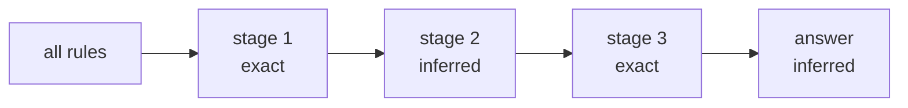

# Fidelity

Each answer from a simulation states how closely it matches what the firewall
would compute. That statement is the **fidelity**.

A simulation runs a sequence of named stages. Each stage narrows the candidate
rules and declares its own fidelity, and the answer carries the weakest one.

| Fidelity | Meaning |
| --- | --- |
| `exact` | The device computes the same result. |
| `overmatch` | The answer can hold rules that the device does not match. A candidate list stays safe. |
| `inferred` | The answer uses data that the device may not use, for example a zone derived from a route, a flow without a user when a rule names a user, or a hop after NAT that looks up its user. |
| `undermatch` | The answer can miss rules that the device matches. |

`--why` shows each stage with its fidelity. The stages of each simulation are
listed on its command page.

## Holes, unresolved entries and notes

An answer can also carry these parts:

| Part | Meaning | Exit code |
| --- | --- | --- |
| hole | a device or vsys that Proteus could not read; the answer covers the rest | 3 |
| unresolved | a value that Proteus recognized but could not evaluate; the answer can miss matches | 3 |
| note | a qualification that leaves the answer unchanged, for example an old snapshot | 0 |

A script can refuse to act on an answer that exits with code 3. See
[Output and exit codes](../reference/output.md).

## Relevance

A firewall is **relevant** to a flow when it has a route to the source or the
destination that is more specific than the default route.

`simulate policy --file` prints a `relevance` line. The line says `unknown`,
because one configuration file holds no forwarding table. Path mode checks the
firewalls on the path and prints no relevance line.
