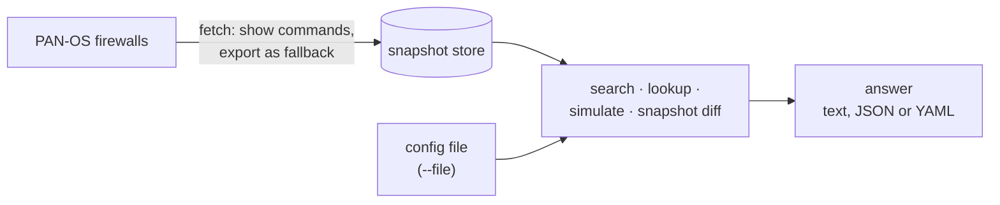

# How Proteus works

Proteus answers questions about PAN-OS firewalls from stored copies of their
configuration and operational state. It reads from a firewall only during
`proteus fetch`, and it never writes to one: the API client refuses every command
except `<show>` commands and the configuration export. The configuration of a
snapshot comes from `show config running` and `show config pushed-template`,
which Proteus merges. The export is the fallback for a firewall that refuses
`show config running`.

1. `proteus fetch` logs in to each firewall in your inventory, reads its
   configuration, its operational state and its User-ID data, and stores them as
   a timestamped [snapshot](snapshots.md).
2. Each question reads the latest snapshot of every selected firewall, so a
   question never waits on the network.
3. With `--file`, a question reads one configuration file instead. You need no
   firewall and no inventory for that.

## Inventory and devices

The **inventory** is a YAML file that lists your firewalls. Each entry is a
**device** with a name, a host, login settings and free-form labels such as
`site: vienna`.

| Selection | Flag |
| --- | --- |
| by name | `--device fw01` |
| by label | `--label site=vienna` |
| every device | no flag |

[Configuration](../reference/configuration.md) describes the file format.

## From a value to a rule

A rule field accepts values from several kinds of object. A security rule's
`source`, for example, accepts an address, an address group, a region, an external
dynamic list and an IP block list. Each kind is a **value space**, and Proteus
reads the value spaces of every field from the PAN-OS schema.

The type of a search term sets how it matches:

| Term | Default match | Example |
| --- | --- | --- |
| address | covered by the value | `10.1.1.5` |
| prefix or range | overlaps the value | `10.1.0.0/16`, `10.1.1.1-10.1.1.9` |
| port | covered by the service | `tcp/8443`, `8443` |
| URL | PAN-OS URL tokens | `shop.example.com/cart` |
| user or group | the user's groups and the rules that name them, with User-ID data | `example.com\alice` |
| anything else | exact name or value | `web-servers` |

A rule field reaches a value in one of four ways:

1. The field names an object whose value matches.
2. The field names a group that holds such an object, at any depth.
3. The field holds the value directly, without an object.
4. The field is `any`.

`search` reports the first three, because it answers where a value appears.
`simulate` uses all four, because it answers which rule a flow hits.

## The schema digest

Every PAN-OS firewall carries its configuration schema. The schema says which
fields exist, which lists hold named entries, and which objects a field can
reference. Proteus embeds a compact **digest** of the PAN-OS 11.2 schema and reads
every configuration version with it. [Architecture](architecture.md#the-schema-digest)
explains how the digest is built.
