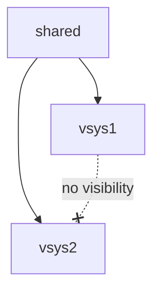

# Scope

A **scope** is `shared` or one vsys. A vsys sees its own objects and the shared
objects, and two vsys never see each other's objects.

Every answer is keyed by device and vsys. The same shared dynamic address group
can hold different members in two vsys, because each vsys adds its own tagged
objects to it. For that reason Proteus resolves a name in one scope at a time.

## Name resolution

A name resolves by scope first and by kind second. A vsys object hides a shared
object of the same name, even when the two have different kinds: a vsys service
hides a shared service group, and a vsys address group hides a shared address.

Below shared, every scope also sees the device's predefined services. A shared or
vsys service or service group of the same name hides them.

## Rule layers

A firewall evaluates security rules in this order:

1. shared pre-rules, pushed by Panorama
2. the vsys's own rules
3. shared post-rules, pushed by Panorama
4. the default rules

A managed firewall carries the rules that Panorama pushed to it, so Proteus reads
each firewall's own configuration and does not read Panorama.
