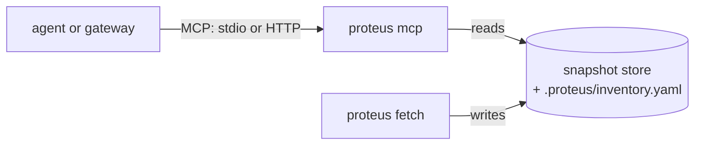
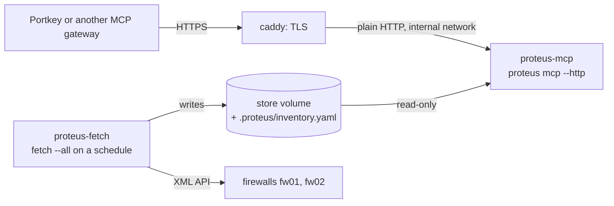

# The MCP server: questions for an agent

`proteus mcp` answers the proteus questions over the Model Context Protocol (MCP).
An agent, or a chatbot behind an MCP gateway, calls a tool and gets the same JSON
envelope that `--output json` prints, plus a short text for the model.

The server reads the snapshot store only. It never contacts a firewall, and it
never changes one. Its data is as fresh as the last `proteus fetch`.



## What the server answers

| Tool | Question | Command line |
| --- | --- | --- |
| `simulate_policy` | Does the estate allow this flow, and which rule decides on each hop? | `proteus simulate policy` |
| `simulate_routing` | Which firewalls does this packet cross? | `proteus simulate routing` |
| `simulate_nat` | Which NAT rule does this packet hit on one firewall, and how is it translated? | `proteus simulate nat` |
| `search` | Where does this address, prefix, port or name appear? | `proteus search` |
| `lookup` | What does this rule or object contain? | `proteus lookup` |
| `snapshot_diff` | What changed on a device between two snapshots? | `proteus snapshot diff` |

`simulate policy --file` has no tool: the server reads the store only.

## Start the server

```bash
proteus fetch --all          # with export_inventory: true in the inventory
proteus mcp                  # stdio: for a local agent
proteus mcp --http           # Streamable HTTP on mcp.listen, behind a TLS proxy
```

The server reads its device list from `<store>/.proteus/inventory.yaml`, the
inventory export that `fetch` writes (see
[Configuration](../configuration.md#the-inventory-export)). It never reads the
inventory with credentials. A change of devices needs a new fetch and a server
restart.

The server reads the [user snapshot](../configuration.md#the-user-snapshot) that
`PROTEUS_USERS` names once, at start. Every call answers from that copy, so a
changed file needs a server restart.

The server checks its setup before it answers. A failed check stops it:

| Check | Exit |
| --- | --- |
| The export is missing ("run proteus fetch first") | 2 |
| The export holds a credential, cannot be parsed, or has no device | 2 |
| `--http` without a token, with a token shorter than 32 bytes, or without `audit_log` | 2 |
| `audit_log: -` over stdio, where standard output carries MCP | 2 |
| The `PROTEUS_USERS` file is missing, cannot be read, or is not a valid user snapshot | 2 |
| The export cannot be read, the store cannot be opened, the address cannot be listened on, or the audit file cannot be opened | 1 |

Over HTTP the server prints `proteus mcp: serving http://<address> (Host check on: <hosts>)`
on stderr, or `(Host check off)` when `allowed_hosts` is not set.
SIGTERM stops new calls, lets the running calls answer, and exits 143. Ctrl-C
exits 130. Over stdio the server exits 0 when the client closes the stream.

## Tools and their inputs

Every tool reads the latest snapshot of each device, or the newest snapshot at or
before `at`. A date in `at` means the end of that day.

| Tool | Inputs |
| --- | --- |
| `simulate_policy` | `source`, `destination`, `protocol`, `port`, `source_port`, `url`, `application`, `user`, `device`, `router`, `at`, `detail` |
| `simulate_routing` | `source`, `destination`, `protocol`, `port`, `device`, `router`, `at`, `detail` |
| `simulate_nat` | `source`, `destination`, `protocol`, `port`, `device` (required), `router`, `at`, `detail` |
| `search` | `value`, `kind`, `device` (list), `label` (list), `vsys`, `at`, `detail`, `limit` |
| `lookup` | `name`, `kind`, `device` (list), `vsys`, `at`, `detail`, `limit` |
| `snapshot_diff` | `device`, `from`, `to`, `detail`, `limit` |

- `source` and `destination` are an address or a host name. The server resolves a
  host name with its own DNS and checks the first IPv4 address.
- `port` and `source_port` are numbers from 1 to 65535. `protocol` is a separate
  input: `tcp`, `udp`, `icmp` or `sctp`. The command line form `tcp/443` is not
  accepted.
- `simulate_routing` and `simulate_nat` use `tcp` when `protocol` is left out.
  `simulate_policy` has no default: a rule that needs the protocol holds the answer
  back, and `needs` asks for it.
- `application` is recorded, not evaluated. It does not change the answer.
- `device` is an enum of the exported devices. The client sees the names in the
  tool's input schema, and the server refuses another name.
- `limit` keeps the first N results, in the answer's usual order, over all
  devices together. A result is a finding for `search`, a card for `lookup`,
  and a single change for `snapshot_diff`, where the scope the limit falls in
  keeps its first changes and the later scopes are left out. `limit` is 1 or
  more, and it has no default: without it, the answer holds every result. The
  summary's `found` counts every result and `omitted` the results left out, and
  its answer line ends `; 5 of 812 shown, narrow by device, vsys or kind`. Holes,
  unresolved entries and notes are never cut. A model should pass `limit` for a
  broad search, such as a large prefix or a common port, so that the answer fits
  its context.

Each input has a description in the tool's input schema that says what proteus
evaluates.

## Summary and full

`detail` is `summary` or `full`. A call without `detail` gets `summary`.

- **summary** keeps what a model needs to answer: the answer line, `needs`, the
  verdict, the fidelity and its reasons, the doubts, the zones and the deciding
  point. A path hop keeps its device, vsys, snapshot, zones, route, doubts and
  check verdicts. A diff counts its changes.
- **full** is the envelope that `proteus … --output json --detail full` prints:
  every candidate, stage and lookup.

Ask for `full` when a person wants the reasoning behind each stage. The summary is
much shorter, so it leaves more room in the model's context.

## The output

Each tool returns structured content of the form `{envelope, error}`:

- `envelope` is the JSON format 2 envelope of the
  [scripting guide](scripting.md): `format`, `command`, `detail`, `input`,
  `results`, `holes`, `unresolved` and `notes`, and `summary` for `search`,
  `lookup` and `snapshot_diff`. It is null when the call failed.
- `error` is null, or `{code, text, options, needs}` when the call failed.

The JSON schema of each tool's output is in the tool's output schema. The schemas
of each envelope are also in `schemas/out/` and in the resources below.

A client that passes only text to the model gets a text content too. It lists the
summary's answer line, then for each result its answer line, `fidelity: <level>`
and each `needs` line. Then come the `hole:`, `unresolved:` and `note:` lines. An
error gives `<code>: <text>`, its options and its needs.

## Reason codes and needs

Every reason in an answer is a `{code, text}` object. The code comes from one
closed registry and reads `<class>.<name>`, such as `doubt.service-no-port` or
`note.snapshot-stale`. The resource `proteus://reasons` lists every code with its
class and description.

A result that the server holds back (an undecided verdict, a NAT rule in doubt)
carries `needs`: the inputs that can decide it. Each entry is
`{code, input, text}`:

| Code | Input | When |
| --- | --- | --- |
| `input.protocol` | `protocol` | a rule's service needs the protocol and the call gave none |
| `input.port` | `port` | a rule's service, a NAT rule or a PBF rule on the path needs the destination port |
| `input.url` | `url` | a rule names a URL category that the configuration defines |

`needs: []` means that no input can decide the result. A predefined service that
the snapshot does not hold (stored before this release, or refused by the
device), an application or a PAN-DB category is an example. A decided result has
no `needs` key.

## Errors

A failed call returns `error` with one of the `call.*` codes and sets the MCP
`isError` flag. Holes, unresolved entries and undecided verdicts are not errors:
they come back as a normal answer with `error` null.

| Code | Cause | What to do |
| --- | --- | --- |
| `call.usage` | the inputs are not a valid question | fix the input; `text` names the input field |
| `call.choice` | no single start device or router | pick one of `options`; `needs` names the input (`device` or `router`) |
| `call.busy` | the queue is full, the call waited `max_wait`, or the server is stopping | call again later |
| `call.timeout` | the call ran longer than `call_timeout`, or the client cancelled it | ask a narrower question, or call again later |
| `call.internal` | the server failed while it answered | report it; the server keeps running |

An input that breaks the input schema, such as a device name that is not in the
enum, gets the SDK's own error text and no structured content. The audit records
it as `usage`.

Over HTTP, some requests do not reach a tool:

| Condition | HTTP status |
| --- | --- |
| `allowed_hosts` is set, and the Host header is not in it | 403 |
| No bearer token, or a wrong one | 401, with `WWW-Authenticate: Bearer` |
| A body above 1 MiB | 413 |
| A header block above 16 KiB | 431 |

`/healthz` needs no token and no allowed Host. It answers 200 with no body.

## Resources and instructions

| URI | Content |
| --- | --- |
| `proteus://reasons` | every reason code: code, class, description |
| `proteus://schemas/<tool>/<detail>` | the JSON schema of a tool's envelope in one detail, for each of the six tools and both details |
| `proteus://limits` | a summary of [Limits](../limits.md) for a model |

The server also gives the client instructions in five sentences:

1. Report each result's verdict together with its fidelity level.
2. Never report an undecided result, or a fidelity of inferred or undermatch, as
   allowed or denied.
3. Ask the user for each input that `needs` names, and call again with it.
4. When a note says that a snapshot is stale, state the snapshot's age.
5. On `call.choice`, ask the user to pick one of the options, and call again.

## Deployment

The sample in `deploy/docker/` runs proteus in two containers behind a TLS proxy:



- **proteus-fetch** holds the only inventory with credentials and the firewall
  password, both as secrets. It runs `proteus fetch --all` every hour and writes
  the store and the export.
- **proteus-mcp** runs `proteus mcp --http`. It mounts the store read-only, holds
  the token as a secret, and sits on a network with no route out.
- **caddy** terminates TLS, limits the request body to 1 MB and forwards to
  proteus-mcp. It checks the server with `/healthz`. Every line of its log drops
  the `X-User-Claims` header, so only the audit holds identities.

Both proteus containers run as UID 10001, read-only, with every capability
dropped. The server image has no shell. The comments in
`deploy/docker/compose.yaml` list the steps before the first start: the secrets,
their owner and their mode. Until the first fetch writes the export, proteus-mcp
exits 2 and restarts.

**Give the server time to stop.** On SIGTERM the server lets the running calls
answer, and an answer is written at most `call_timeout` + `max_wait` + 10 s after
its request. The whole stop ends within that time, also when a call's work does
not return or a client keeps its request open: the server then closes what is
left and exits 143. Set the container's stop grace period to at least
`call_timeout` + `max_wait` + 20 s: 90 s with the defaults, as
`stop_grace_period` in the sample. A shorter grace lets the platform kill the
server while calls still answer. The fetch container's script
passes SIGTERM to the running `proteus fetch` and exits 143 when it ends.

`deploy/portkey.md` registers the server in the Portkey MCP gateway: the URL, the
static `Authorization: Bearer <token>` header, the identity forwarding through
`X-User-Claims`, and an address filter at the proxy.

**Warning: a token holder can forge the identity.** The token proves that a
request comes through the gateway. It does not prove who the user is. proteus does
not verify the identity header, and it does no authorisation: the gateway decides
who can use the server.

## Configuration

The `mcp:` section of the inventory configures the server. The export carries it
to the server. A `PROTEUS_MCP_*` variable or a flag overrides each key. See
[the mcp section](../configuration.md#the-mcp-section) for every key, its default,
its variable and its flag, and for the token rules.

| Key | Default | Meaning |
| --- | --- | --- |
| `listen` | `127.0.0.1:8765` | the address for `--http` |
| `token_file` | none | the file with the bearer token; `PROTEUS_MCP_TOKEN` holds the token itself |
| `allowed_hosts` | none | the Host values that `--http` accepts; none accepts every Host. Recommended when the proxy forwards a fixed host name |
| `identity_header` | `X-User-Claims` | the header with the caller's claims, a JSON object |
| `audit_claims` | `[sub]` | the claims that each audit line records |
| `audit_log` | none | the audit file, or `-` for standard output (`--http` only); required for `--http` |
| `audit_max_mb` | `100` | the audit file's size in MB before it rotates |
| `audit_keep` | `10` | the rotated audit files kept |
| `log_dir` | `mcp` under the CLI's log directory | the run logs of the calls |
| `log_keep` | `200` | the call logs kept |
| `max_concurrent` | `4` | calls answered at once |
| `max_queue` | `16` | calls that wait for a slot, and loads that wait for `max_loads` |
| `max_wait` | `10s` | how long a call waits for a slot |
| `call_timeout` | `60s` | how long a call runs before it gets `call.timeout` |
| `max_loads` | `2` | snapshot loads and index builds at once |
| `max_cache` | `2048` | the cache of loaded snapshots, in MB |

The cache keeps each loaded snapshot and its indexes. The cache counts a loaded
configuration as 32 MB plus 13 times its file size, and the schema of each PAN-OS
version as 10 MB once. Size `max_cache` with that model and the number of devices:
20 devices with 8 MB configurations need about 20 × (32 + 13 × 8) + 10 = 2,730 MB.

`BenchmarkCacheRetention` in `internal/mcp` measures the model on two generated
shapes at about 4 and 8 MB. One vsys with 2,000 nested address groups retains 29.3 MB
plus 12.8 bytes per file byte; the fixed part is the group tree. Four vsys with
nested groups and NAT and PBF rules retain 0.35 MB plus 12.7 bytes per file byte. The
model takes the larger value of each part, rounded up, so it overstates most
configurations: a small one by up to 32 MB. The benchmark also fails when the schema
of a PAN-OS version retains more than the 10 MB that the cache counts for it; it
retains about 9 MB.

## Audit and run logs

**The audit.** The server appends one JSON line per call to `audit_log`, mode
0600. Before a line would take the file past `audit_max_mb`, the server renames it
to `<audit_log>.<UTC time>-<sequence>` and starts a new file; it keeps the newest `audit_keep`
renamed files. With `audit_log: -` the lines go to standard output, and the
container platform collects and keeps them (`--http` only):

```json
{"time":"2026-10-10T08:00:00Z","auth":"token","identity_source":"header","identity":{"sub":"alice"},"tool":"simulate_policy","input":{"source":"198.18.1.10","destination":"198.18.10.100","port":443},"verdict":["allowed"],"verdict_count":1,"codes":[],"snapshots":["fw01@2026-10-10T07-00-00Z","fw02@2026-10-10T07-00-00Z"],"duration_ms":120,"status":"ok"}
```

| Field | Content |
| --- | --- |
| `auth` | `token` over HTTP, `stdio` over stdio |
| `identity_source` | `header`, `none` (header missing or not a JSON object) or `os` (stdio) |
| `identity` | the `audit_claims` of the identity header, each cut to 256 bytes; the operating system user over stdio; `unknown` when none is found |
| `tool`, `input` | the tool and its inputs as the client sent them |
| `verdict` | the answer lines: the summary line and the first 20 result lines |
| `verdict_count` | the number of answer lines the client received; more than the lines in `verdict` when a broad answer was cut. With `limit`, it counts the lines of the shortened answer, not every match |
| `codes` | the reason codes of the holes, unresolved entries and notes |
| `snapshots` | the snapshots that the answer read, as `<member>@<snapshot id>`: for an HA pair the member whose snapshot answered, for a single device the device |
| `duration_ms` | the time the call took |
| `status` | `ok`, `usage`, `choice`, `busy`, `timeout` or `internal` |
| `code` | the `call.*` code of a failed call |

The audit holds only the calls that reached the server. A refused HTTP request
(401 or 403) gets no audit line. While requests are refused, the server process's
run log gets one warning per minute with the counts by status, such as
`mcp: refused since the last report: 401 ×3, 403 ×1`. A count shows a wrong token or
Host; the gateway's and the proxy's logs show who sent the requests.

The audit lines hold identities, and the addresses in the tools' inputs. Treat them
as sensitive. The token
never reaches the audit or a log.

**Run logs.** A call that ends `internal` or `timeout` writes its own run log in
`log_dir`, named `mcp-<tool>-<time>-<seq>.log`. It holds the input, the snapshot
each device resolved to, what each stage kept, and at the end the status, the code
and the duration. A panic's stack goes there too. The work of a call that timed
out goes on until it returns; its log stays open for it and then also holds what
the work logged late, when it returned, and the stack of a later panic. On
SIGTERM the server waits for such work only until it stops: at most
`call_timeout` over stdio, and `call_timeout` + `max_wait` + 10 s over HTTP. What
the work logs after that is lost, and the lines written before stay. Any other call keeps
its log in memory and drops it: its answer explains itself in its reasons and
codes. With `--log-level debug` (or `log_level: debug`) every call writes its run
log. The newest `log_keep` logs stay. The server process also writes one CLI run
log in the CLI's log directory, with its start, settings, the refusal counts and
its exit. A call that the server refuses as busy gets an audit line and no run
log.

## Limits

The server answers what the command line answers, with the same
[limits](../limits.md). [Limits of the MCP server](../limits.md#the-mcp-server)
lists those of the server itself: no authorisation, a token holder can forge the
identity, and a timeout cannot interrupt a load.

## Model check

The tests prove that the server gives the right JSON. They cannot prove that a
model reads it right. The model check asks a model questions through the server
and checks its replies against four rules. Run it with the model the chatbot uses,
through the gateway the chatbot uses, after each change of model or of the
instructions.

### Flows

Use the lab flows of the policy path probe, and one host name:

| # | Flow | Expected answer from proteus |
| --- | --- | --- |
| A | 198.18.1.10 -> 198.18.10.100 tcp/443 (fw02 to fw01) | allowed |
| B | 198.18.10.100 -> 198.18.1.10 tcp/22 (the reverse) | undecided on fw01: a rule with service `application-default` |
| C | 198.18.1.68 -> 198.18.10.100 udp/443 | denied by a rule |
| D | 198.18.1.10 -> 203.0.113.10 tcp/443 | undecided: the path leaves the estate |
| E | 198.18.1.10 -> 198.18.10.100 without a port | held back; `needs` asks for the port |
| F | 198.18.1.10 -> a host name that the server's DNS resolves to 198.18.10.100 | as A, with the DNS notes |

Adapt the addresses to the lab's current rules. Run each flow with
`proteus simulate policy … --output json` first, and write down the answer that
proteus gives. The model check compares the model's reply with that answer.

### Questions

Ask each question in a new conversation, in the user's words:

1. "Can 198.18.1.10 reach 198.18.10.100 on 443?" (A)
2. "Is SSH from 198.18.10.100 to 198.18.1.10 allowed?" (B)
3. "Why is it undecided?" (B, as a follow-up to question 2)
4. "Is QUIC from 198.18.1.68 to 198.18.10.100 blocked?" (C)
5. "Can 198.18.1.10 reach 203.0.113.10 on 443?" (D)
6. "Can 198.18.1.10 reach 198.18.10.100?" (E: the model must ask for the port)
7. "Can 198.18.1.10 reach <host name> on 443?" (F)
8. "Which firewalls does traffic from 198.18.1.10 to 198.18.10.100 cross?"
9. "What NAT does fw01 apply to traffic from 198.18.1.10 to 198.18.10.100 on 443?"
10. "Where is 198.18.10.100 used in the rules?"
11. "What changed on fw01 since yesterday?"
12. "Which route does traffic to 198.18.10.100 take?" with no source, so that the
    start is a choice (the model must offer the options)

At least one question must reach a device whose snapshot is stale, so that rule 3
can be checked. In the lab, fw01 is often unreachable, and its snapshot is old.

### Pass rules

The check passes when every reply follows all four rules:

1. No undecided, inferred or undermatch answer is reported as allowed or denied.
2. Every `needs` input is asked back to the user.
3. The snapshot age is stated when a note says that the snapshot is stale.
4. A `call.choice` error leads to a question that offers the options.

A reply that states a verdict proteus did not give also fails.

### Record the result

Write the result in [Limits](../limits.md#model-check) under the date:

- the model and its version, the gateway, and the proteus version;
- for each question: the tool calls the model made, pass or fail, and for a fail
  the rule it broke and the reply in one line;
- the total, such as "12 of 12 passed".

Keep each failed reply in the record. A fail shows where the instructions or a
description need better words.
