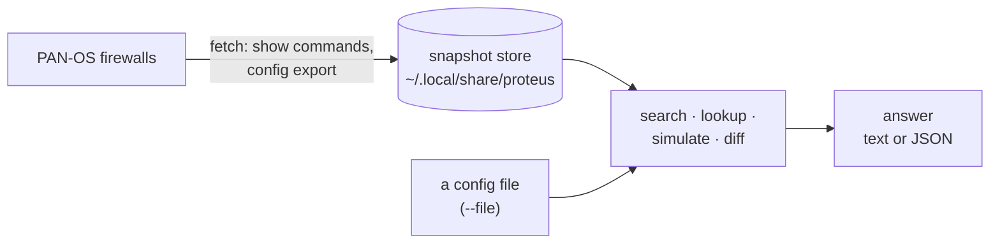

# proteus

proteus answers questions about PAN-OS firewalls. It reads each firewall's
configuration and operational state, keeps a copy on disk, and answers from that
copy. It never changes a firewall.

## What it answers

| Question | Command |
| --- | --- |
| Where does this address, port, URL, user or name appear? | `proteus search` |
| What does this rule or object contain? | `proteus lookup` |
| Which security rule would this flow hit? | `proteus simulate policy` |
| Which NAT rule would this packet hit, and what does the packet look like after it? | `proteus simulate nat` |
| Which firewalls does this packet cross, and through which zones? | `proteus simulate routing` |
| What changed on a firewall since last week? | `proteus snapshot diff` |

Every answer says how certain it is. When proteus cannot evaluate part of a
question, the answer names that part. It does not hide it.

## How it works, in one picture

1. `proteus fetch` logs in to each firewall in your inventory. It reads the
   running configuration and the operational state, and stores them as a
   timestamped snapshot.
2. Every question reads the latest snapshot of each selected firewall. No
   question contacts a firewall.
3. `--file` reads one configuration file instead. You need no firewall and no
   inventory for that.

## Where to go next

- **[Getting started](getting-started.md)**: build proteus and ask your first
  questions, with or without a firewall.
- **[Concepts](concepts.md)**: snapshots, scopes, value spaces and how certain an
  answer is.
- **Guides**: [search](guides/search.md), [lookup](guides/lookup.md),
  [simulate policy](guides/simulate-policy.md),
  [simulate NAT](guides/simulate-nat.md),
  [simulate routing](guides/simulate-routing.md),
  [snapshots](guides/snapshots.md) and
  [scripting](guides/scripting.md).
- **[Configuration](configuration.md)**: the inventory, settings and paths.
- **[CLI reference](cli-reference.md)**: every command and flag.
- **[Architecture](architecture.md)**: the packages and how data flows through
  them.
- **[Limits](limits.md)**: what proteus does not evaluate yet.
- **[Development](development.md)**: build, test and extend proteus.
